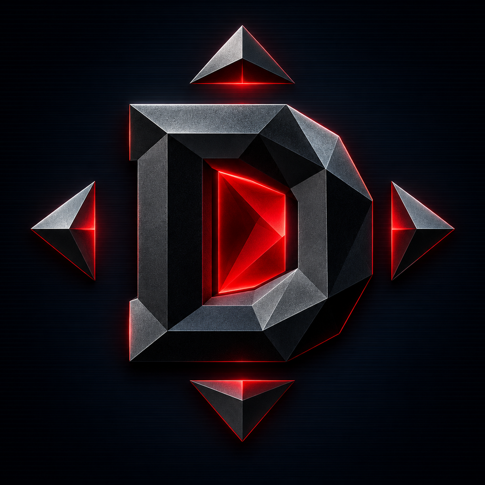

# DarkPad

<p align="center">
  
</p>

<p align="center">
  <strong>Perfect Dark, native on iPhone and iPad.</strong><br>
  The decompiled N64 classic compiled as a real ARM64 app, with GoldenPad-style
  touch and controller play, optional HD art and solid saves. You supply the game.
</p>

<p align="center">
  
  
  
  
  
  <a href="https://github.com/chrissotraidis/padmint"></a>
  <a href="https://discord.gg/xwHfUD2bxW"></a>
</p>

<p align="center">
  <strong><a href="#get-darkpad">Get DarkPad</a> ·
  <a href="#controls">Controls</a> ·
  <a href="#whats-on-the-main-menu">Main menu guide</a> ·
  <a href="#graphics-and-add-ons">Graphics and add-ons</a> ·
  <a href="#faq">FAQ</a> ·
  <a href="https://discord.gg/xwHfUD2bxW">Discord</a></strong>
</p>

DarkPad runs the [Perfect Dark decompilation](https://github.com/n64decomp/perfect_dark)
as a native iPhone and iPad app. The game's original C source, rebuilt by the
decompilation project, is compiled ahead of time for Apple's ARM64 chips: there is
no emulator and no JIT. [ANGLE](https://chromium.googlesource.com/angle/angle)
turns its OpenGL ES rendering into Metal.

The engine is [Dab's Mod](https://github.com/DabDavis/perfect-dark-dabs-mod) v3.15.1,
an extended fork of the [Perfect Dark PC port](https://github.com/perfect-dark-pc-port/perfect_dark).
DarkPad starts from rebelancap's [perfect-dark-ios](https://github.com/rebelancap/perfect-dark-ios)
shell, including its 1.0.4 online fixes, and adds GoldenPad's controls and menu,
a fixed controller path, touch and gyro look over the network, simpler art
settings and a reproducible one-command build.

> [!IMPORTANT]
> No game data is included and no IPA is published. You build your own copy on an
> Apple Silicon Mac, then choose your own **Perfect Dark (USA) Rev 1 / v1.1** ROM in
> the app. See [Get DarkPad](#get-darkpad).

> [!NOTE]
> **AI disclosure:** DarkPad uses substantial AI assistance for code, tests,
> documentation, debugging and maintenance. There is no audited percentage of
> AI-generated code. Build and test records describe what was checked. This
> disclosure concerns DarkPad's workflow, not the authorship of its upstream
> projects.

## Get DarkPad

You need an Apple Silicon Mac with Xcode, about 30 GB of free space for the first
build, your own Perfect Dark ROM, and a way to install your own app: AltStore
Classic, SideStore, Sideloadly or Xcode.

**With PadMint (recommended, once DarkPad's first release is published):**

1. Once, install the tools PadMint does not fetch itself: `brew install cmake ninja xcodegen`.
2. Download [PadMint](https://github.com/chrissotraidis/padmint/releases/latest),
   unzip it and double-click `PadMint.command`. Choose DarkPad and click
   **Make my copy**. PadMint builds DarkPad from this repository and saves an
   unsigned IPA in your Downloads folder.
3. Install that IPA with your sideloading tool, open DarkPad, and choose your ROM.

The first build downloads ANGLE's sources and takes a while; later builds reuse
them. **By hand:** follow [Build from source](#build-from-source).

Update by installing a new IPA over the old one, signed the same way. Deleting
the app deletes your saves, settings and imported art.

| Option | Status |
|---|---|
| Build on an Apple Silicon Mac by hand | **Works** |
| Build with PadMint | **Recipe ready**; listed once DarkPad publishes its first release |
| Windows or Linux | Not yet |
| Prebuilt IPA, App Store, TestFlight | Not offered |

## Status

DarkPad 0.1.0 is a **developer preview**. On the maintainer's iPad Pro (12.9-inch,
6th generation) with an Xbox Wireless Controller, controller play, the ••• menu,
audio and frame pacing behaved as intended in hands-on play on the previous
engine (Dab's Mod v3.14.0). The current build moves to v3.15.1: it is installed on
that iPad with saves intact, and on Simulators it loads saves, plays Carrington
Institute, GoldenEye's Dam and Combat Simulator matches, and joins and hosts
online games with desktop Dab's Mod. Hands-on play of the v3.15.1 build on the
iPad, the full campaign, touch-only play on a phone, heat and battery use, and
multiplayer between two real devices have not been tested yet. See
[Current limitations](#current-limitations).

## Controls

### Controller

Xbox, PlayStation and MFi controllers work. New installs use GoldenPad's layout,
adjusted for Perfect Dark's extra actions:

| Action | Controller |
|---|---|
| Move and strafe | Left stick |
| Turn and look | Right stick |
| Step and strafe | D-pad |
| Fire / Aim | RT / LT |
| Crouch | LB |
| Next weapon | A, Y, RB |
| Use (doors, switches) | B, X |
| Reload | Left-stick click |
| Secondary function | Right-stick click |
| Weapon wheel and gadgets | View / Back |
| Pause | Start |
| Menu accept / cancel | A / B |

While a controller is connected the touch buttons hide (On-Screen Controls: Auto).
**Settings → Controller → Use GoldenPad Controller Layout…** restores this layout
and keeps a backup of your previous bindings.

### Touch

| Control | What it does |
|---|---|
| **Left side** | Virtual stick: move and strafe |
| **Right side drag** | Look and turn |
| **FIRE** | Fire (the largest button) |
| **AIM** | Aim mode; hold and drag to steer while aiming |
| **USE** | Doors, switches and pickups |
| **RELOAD** | Reload |
| **WEAPON** | Next weapon; hold for the weapon wheel |
| **DUCK** | Cycles standing, crouching and low crouch |
| **NEXT / ALT** | Next weapon, and the weapon's secondary function |
| **START** | The game's own pause and inventory menu |
| **BACK** | Leaves the game's own menus; shown only while one is open |
| **CHAT** | Opens the chat line in an online match; shown only then |

**••• → Controls → Edit Touch Controls** moves, resizes (55–160%) and fades
(20–100%) any button over the live game. iPhone and iPad layouts are saved
separately. Touch Control Settings has look speed, invert look, control style,
haptics and double-tap to roll.

**Gyro while aiming** (experimental) tilts the view while you hold Aim.

## The ••• menu

The round ••• button in the upper-right corner pauses the game and opens DarkPad's
menu. It follows the same layout as GoldenPad, SunPad, MeleePad and GalaxyPad.

| Item | What's inside |
|---|---|
| **Display** | Art profile, frame rate, render resolution, FPS counter |
| **Controls** | Edit Touch Controls, on-screen controls, touch settings, GoldenPad controller layout, gyro aiming |
| **Audio** | Volume, mute, how DarkPad shares audio with other apps |
| **Optional Add-ons** | HD texture packs, Xbox 360 remaster art, GoldenEye levels. None are included |
| **All Settings…** | The full settings page |
| **Help & Feedback** | Report a Problem…, Share Diagnostic Log, Build & Performance, About DarkPad, DarkPad on GitHub |
| **End Mission or Match…** | Ends the current mission or match after confirmation; completed progress is kept |

**Report a Problem…** asks what went wrong, writes a diagnostic log you can review
and share, then offers a prefilled GitHub issue. Nothing is uploaded
automatically, and the log never includes your ROM, saves or imported art.
**START** stays the game's own pause menu.

## What's on the main menu

After you choose an agent file, Perfect Dark's **Perfect Menu** appears. Some
entries are the original game's and some come from Dab's Mod, the engine DarkPad
is built on.

| Entry | From | What it is |
|---|---|---|
| **Carrington Institute** | Original game | The walkable hub: training, firing range, holograph tests and gadget practice |
| **Solo Missions** | Original game | The campaign. Start here; Defection is the first mission |
| **Combat Simulator** | Original game | Bot matches and challenges. The engine allows up to 80 simulants; DarkPad has been tested with up to eight |
| **Co-Operative / Counter-Operative** | Original game | Split-screen campaign modes for two players on one screen |
| **Customize Character** | Dab's Mod | Choose the character model used in missions |
| **Ghost Trials** | Dab's Mod | Race a recorded ghost run of a mission |
| **Randomizer** | Dab's Mod | A mission reshuffled from its own pieces, or an endless run of rooms across every map |
| **GoldenEye** | Dab's Mod | GoldenEye 007's missions and arenas in the Perfect Dark engine (GE Plus); appears once you add your own GoldenEye ROM |
| **Goldfinger 64 / Tomorrow Never Dies 64** | Dab's Mod | GoldenEye ROM hacks, each with its own row; appear once you add the hack's files |
| **Online Game** | Dab's Mod | Online Lobbies, LAN and Direct Connect. See [Multiplayer](#multiplayer) |

**Leaving GoldenEye:** in a mission, open the watch (Start) and choose Abort, or
use ••• → End Mission or Match. On GoldenEye's folder, B, BACK or the PREVIOUS tab
steps back a page; from its first page it returns to the Perfect Menu.

The game's **Options → Extended Options** page holds Dab's Mod and PC-port
settings such as field of view, crosshair and gameplay tweaks. DarkPad manages
frame rate, resolution and controls itself, so change those in the ••• menu.

## Graphics and add-ons

| Setting (••• → Display) | Options | Notes |
|---|---|---|
| **Art Profile** | Original, Enhanced, Remaster | Original is the N64 look. Enhanced adds 2× texture filtering plus an HD pack if you install one. Remaster uses your own Xbox 360 art |
| **Frame Rate** | 60 Hz (default), up to your display's maximum | Above 60 Hz is experimental. Dab's Mod v3.15.1 fixed the guns, doors, lifts, enemies and HUD that used to run fast; on a Simulator the game clock and walking speed at 120 frames per second match 60. Not yet measured on an iPad |
| **Render Resolution** | Native, 75%, 50% | Lower trades sharpness for speed; applies on next launch |
| **Show FPS Counter** | On, Off | |

Every add-on is optional, none is included, and each needs files you supply:

- **HD texture packs.** Put a pack folder or archive in
  **Files → On My iPhone/iPad → DarkPad → texture-packs**, restart, choose
  **Enhanced**, then pick the pack under **Optional Add-ons → HD Texture Packs**.
  The community **PD Forever Plus HD v0.10** pack has been tested. Check each
  pack's terms before sharing it.
- **Xbox 360 remaster art.** Add your own copy of the 2010 Xbox 360 release to
  **Files → DarkPad → added-content**, then choose **Remaster**. Without it,
  Remaster falls back to N64 art. Not yet tested with a real package.
- **GoldenEye levels (GE Plus).** Add your own GoldenEye 007 (US) ROM, and
  optionally the GoldenEye XBLA package, under **••• → Optional Add-ons →
  GoldenEye Levels** or in **Files → DarkPad → added-content**. **GoldenEye**
  appears on the Perfect Menu after a restart; the first launch converts the
  levels. On a Simulator with a US ROM, the folder menus, mission select and Dam
  load and play at 60 fps; the full GoldenEye campaign has not been played.
- **Goldfinger 64 and Tomorrow Never Dies 64.** These GoldenEye ROM hacks come as
  `goldfinger64.zip` and `tnd64.zip`, which patch your GoldenEye ROM. Add them
  with the ROM hack row in the same place; each gets its own Perfect Menu row.
  Supported by the engine, not yet tested in DarkPad.

## Multiplayer

**Online Game** on the Perfect Menu is Dab's Mod's netplay: Combat Simulator
matches, co-op and counter-op missions for up to 12 players, with a Game Lobby and
chat. DarkPad speaks the same protocol (33) as desktop Dab's Mod v3.15.1 and
reports the same build identity, so iPhone, iPad, Mac and PC players can share a
room.

| Page | What it does | Status in DarkPad |
|---|---|---|
| **Direct Connect** | Host a room, or join one by typing its address (`192.168.1.5` or `192.168.1.5:27100`) | Joined and hosted against desktop Dab's Mod on a Simulator |
| **LAN** | Lists rooms on your network by broadcast | Create Room works; finding rooms needs Apple's multicast entitlement, which DarkPad does not have yet, so use Direct Connect |
| **Online Lobbies** | Rooms on Dab's lobby server; your account is a name and a PIN | Present; not tested |

Touch and gyro look work online: DarkPad sends them inside the same look fields
a desktop mouse uses, so the host turns your player exactly as you see it. iOS
asks once for Local Network access. A host's firewall must allow UDP 27100–27103.

On one device, **Combat Simulator** bot matches and challenges work, and the
original split-screen modes are present but untested with several controllers
on one iPad. See [network integration](docs/network-integration.md) for the
test record.

## Supported game

| Game | Revision | Status |
|---|---|---|
| **Perfect Dark** | USA Rev 1 (v1.1), 32 MiB, MD5 `e03b088b6ac9e0080440efed07c1e40f` | Supported |
| Perfect Dark | PAL, Japanese, USA v1.0 | Recognized and refused with an explanation |
| GoldenEye 007, Goldfinger 64, Tomorrow Never Dies 64 (Expanded 06-22) | US | Optional extras for GE Plus only |

The importer accepts `.z64`, `.v64` and `.n64` and copies the ROM into
DarkPad's private storage; your original file is not changed.

## Build from source

You need an Apple Silicon Mac with Xcode, Python 3.9 or newer, and Homebrew:

```sh
brew install cmake ninja xcodegen
git clone https://github.com/chrissotraidis/darkpad.git
cd darkpad
scripts/build-personal-ipa.sh ~/Downloads/DarkPad.ipa
```

This fetches the pinned engine, SDL2, curl and ANGLE, applies DarkPad's patches
and builds an unsigned Release IPA for iPhone and iPad. It is the same command
PadMint runs. The first run downloads ANGLE's sources (over 10 GB); everything is
cached under the ignored `vendor/`, `work/` and `build/` folders.

To sign and install directly with your own Apple developer team instead:

```sh
PD_PUBLIC=1 scripts/gen-app-project.sh
xcodebuild -project app/perfectdark.xcodeproj -scheme perfectdark \
  -configuration Release -sdk iphoneos -derivedDataPath build/dd-device-signed \
  DEVELOPMENT_TEAM=YOURTEAMID PRODUCT_BUNDLE_IDENTIFIER=com.yourname.darkpad \
  CODE_SIGN_STYLE=Automatic -allowProvisioningUpdates build
xcrun devicectl device install app --device YOUR_DEVICE_ID \
  build/dd-device-signed/Build/Products/Release-iphoneos/perfectdark.app
```

<details>
<summary><strong>Developer builds: Simulator, Mac reference and validation</strong></summary>

`scripts/bootstrap-apple.sh` builds the Simulator app, an unsigned device app and a
native Mac reference. Install the Simulator build with:

```sh
xcrun simctl install booted build/dd-iphonesimulator/Build/Products/Debug-iphonesimulator/perfectdark.app
xcrun simctl launch booted com.chrissotraidis.darkpad
```

Development builds include a test console on TCP 8775, reachable only from the
same machine; `PD_PUBLIC=1` builds leave it out. Validate a ROM and run the Mac
reference with:

```sh
scripts/validate-rom.py '/path/to/your/Perfect Dark.z64' --stage work/gamedata/pd.ntsc-final.z64
scripts/run-oracle.sh -- --skip-intro
```

Source revisions are pinned in `UPSTREAM_PIN` and `dependencies/pins.env`; the
detailed engineering log is [PROGRESS.md](PROGRESS.md).

</details>

## If it does not work

- **The ROM is refused.** The message names the revision or byte order it found.
  Only USA Rev 1 (v1.1) is supported. Copy cloud files to **On My iPhone/iPad** first.
- **The on-screen buttons disappeared.** A connected controller hides them in
  Auto mode. Set **••• → Controls → On-Screen Controls** to **On**.
- **The game seems fast.** Set **••• → Display → Frame Rate** to 60 Hz.
- **Stuck in GoldenEye.** Abort from the watch, then press B or BACK, or tap
  PREVIOUS, until the Perfect Menu returns.
- **No LAN rooms listed.** Use **Online Game → Direct Connect** with the host's
  address; LAN room finding needs an entitlement DarkPad does not have yet.
- **Art did not change.** Resolution and newly added texture-pack archives apply
  after restarting DarkPad.

Report anything else with **••• → Help & Feedback → Report a Problem…**, or open a
[GitHub issue](https://github.com/chrissotraidis/darkpad/issues) with your device,
OS version, DarkPad build (from **About DarkPad**) and the steps that led to it.
Never attach ROMs, extracted art, saves or signing files.

## Current limitations

- Physical testing so far is one iPad Pro with an Xbox controller. iPhone touch
  play, heat and battery use are not measured.
- Only the first missions, Challenge 1 and bot matches have been played through.
- The v3.15.1 engine has not yet been played by hand on the iPad. Above 60 Hz
  stays experimental until it is measured there.
- Gyro aiming is experimental and uncalibrated on hardware.
- Xbox 360 remaster art has not been tested with a real package. GE Plus has
  been played only briefly, on a Simulator; Goldfinger 64 and TND64 not at all.
- Online play has been tested only on Simulators and a Mac on one machine: no
  real devices, Wi-Fi, internet lobby or completed co-op mission yet. LAN room
  finding does not work without the multicast entitlement.

## FAQ

<details>
<summary><strong>Is DarkPad an emulator?</strong></summary>

No. Perfect Dark's decompiled source is compiled into a native ARM64 iPhone and
iPad app. ANGLE translates its OpenGL ES rendering to Metal.
</details>

<details>
<summary><strong>Does this repository contain Perfect Dark?</strong></summary>

No. It contains the Apple shell, engine patches, build scripts and documentation.
You supply your own legally obtained ROM.
</details>

<details>
<summary><strong>Where is the IPA?</strong></summary>

None is published, because the app contains code compiled from the game. Build
your own with PadMint or the command in [Build from source](#build-from-source).
</details>

<details>
<summary><strong>Can I play online?</strong></summary>

Yes, through **Online Game** on the Perfect Menu, with other DarkPad players and
desktop Dab's Mod v3.15.1 players. It is new and has been tested only on
Simulators and a Mac so far; see [Multiplayer](#multiplayer).
</details>

<details>
<summary><strong>Why 60 Hz by default on a ProMotion display?</strong></summary>

60 Hz is the speed the game was designed for. Dab's Mod v3.15.1 fixed most of
what used to run fast above 60 Hz, and Simulator measurements at 120 frames per
second look right, but 120 Hz stays opt-in until it has been played on an iPad.
</details>

## Project map

| Path | Purpose |
|---|---|
| [`app/ios/`](app/ios/) | Native shell: touch overlay, controller, ••• menu, settings, onboarding, audio |
| [`overlay/patches/`](overlay/patches/) | Ordered engine patches applied to the pinned upstream at build time |
| [`overlay/network-candidate/`](overlay/network-candidate/) | Retired: the earlier networking experiment on an intermediate engine |
| [`scripts/`](scripts/) | Bootstrap, build, packaging and validation scripts |
| [`padmint.json`](padmint.json) | PadMint build recipe |
| [`tests/`](tests/) | Focused tests for input, networking, textures and save isolation |
| [docs/acceptance.md](docs/acceptance.md) | What has been verified and what remains |
| [docs/goldenpad-reference.md](docs/goldenpad-reference.md) | How GoldenPad's controls and menu were adapted |
| [docs/ART.md](docs/ART.md) | App icon provenance |
| [PROGRESS.md](PROGRESS.md) | Detailed engineering log |

## Community and support

[Join the Discord](https://discord.gg/xwHfUD2bxW) for help and news. It is one
community for DarkPad and its sibling projects, such as GoldenPad, KartPad,
MeleePad and BlueWake. Read [Contributing](CONTRIBUTING.md) before proposing a
change and [Security](SECURITY.md) before reporting a vulnerability.

## Legal and acknowledgements

DarkPad is an unofficial preservation project. It is not affiliated with or
endorsed by Rare, Microsoft, Nintendo or 4J Studios. Perfect Dark and all related
names, characters and game content belong to their respective owners.

DarkPad builds on the [Perfect Dark decompilation](https://github.com/n64decomp/perfect_dark),
the [Perfect Dark PC port](https://github.com/perfect-dark-pc-port/perfect_dark),
[Dab's Mod](https://github.com/DabDavis/perfect-dark-dabs-mod),
rebelancap's [perfect-dark-ios](https://github.com/rebelancap/perfect-dark-ios),
SDL2, curl and ANGLE. The Apple shell is MIT-licensed; each upstream component
keeps its own license. Full notices are in [LICENSE](LICENSE).
